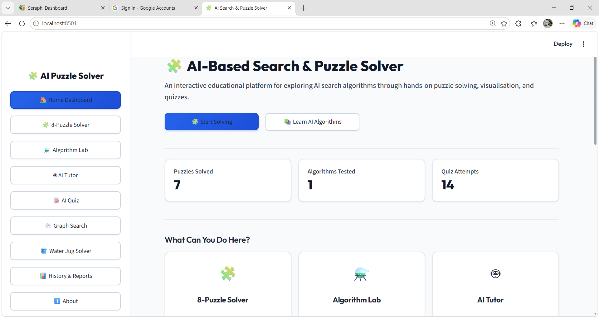
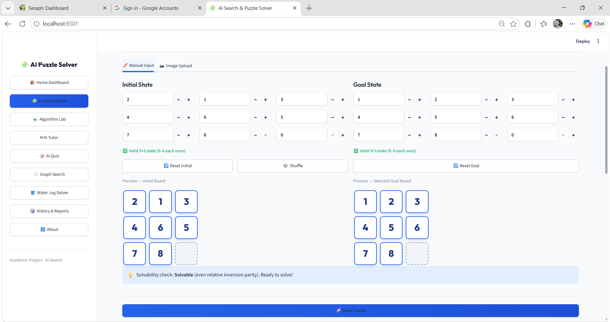
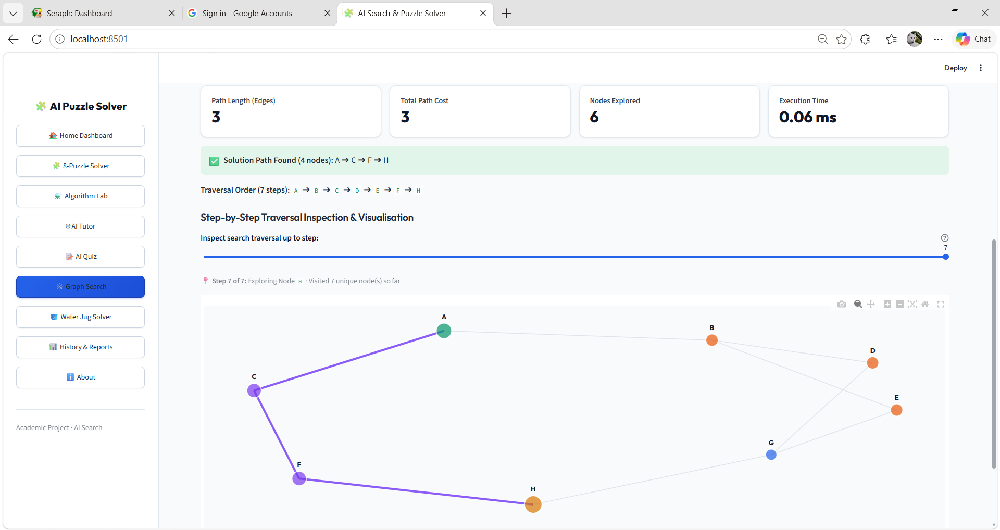
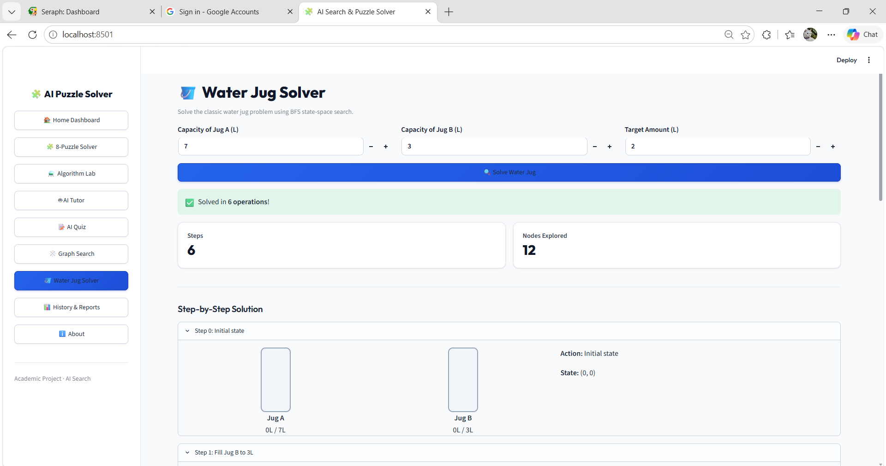
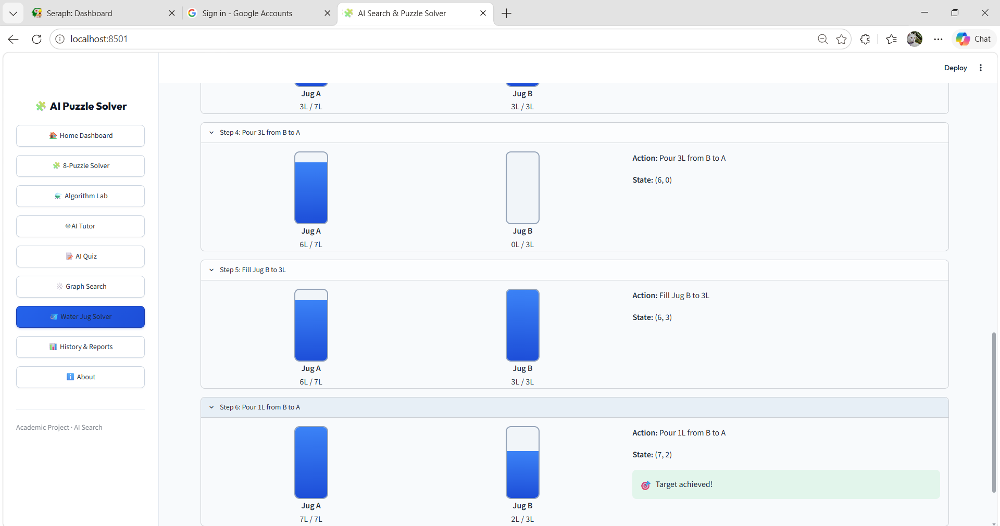

# 🧩 AI-Based Search & Puzzle Solver

[](https://www.python.org/)
[](https://streamlit.io/)
[](https://plotly.com/)
[](https://networkx.org/)
[](https://opencv.org/)
[](https://github.com/tesseract-ocr/tesseract)
[](https://opensource.org/licenses/MIT)

> **Interactive Artificial Intelligence Search Algorithm Exploration, State-Space Optimization, and Heuristic Graph Pathfinding Suite.**

---

## 📌 Table of Contents
1. [Project Overview & Problem Statement](#-project-overview--problem-statement)
2. [Live Demonstration](#-live-demonstration)
3. [Key Features](#-key-features)
4. [Search Algorithms & Theoretical Analysis](#-search-algorithms--theoretical-analysis)
5. [Technology Stack](#-technology-stack)
6. [Project Architecture & Directory Structure](#-project-architecture--directory-structure)
7. [Installation & Setup (Windows)](#-installation--setup-windows)
8. [Module Usage Guide](#-module-usage-guide)
9. [Interface Screenshots](#-interface-screenshots)
10. [Algorithm Implementations & Mathematical Formulations](#-algorithm-implementations--mathematical-formulations)
11. [Testing Suite](#-testing-suite)
12. [Known Limitations & Future Enhancements](#-known-limitations--future-enhancements)
13. [Author & Academic Profile](#-author--academic-profile)

---

## 📖 Project Overview & Problem Statement

Classical artificial intelligence search problems—such as the **8-Puzzle sliding tile problem**, **unweighted/weighted graph traversal**, and the **two-jug Water Jug Diophantine problem**—serve as foundational benchmarks for exploring algorithmic completeness, state-space exploration efficiency, heuristic admissibility, and time/space complexity.

### The Problem
- The **8-Puzzle** state space comprises $9! = 362,880$ permutations split into two disconnected reachable components ($181,440$ states each) governed by relative permutation parity. Uninformed search techniques can rapidly exhaust system memory ($O(b^d)$ space), while improperly formulated heuristics violate admissibility, producing suboptimal paths.
- Abstract search algorithm comparisons in textbooks often obscure real-world execution metrics such as runtime latencies, generated nodes versus expanded nodes, and deep branch backtracking penalties.

### The Solution
This web application provides a full-stack, modular platform that pairs rigorous algorithmic implementations with real-time state visualization, automated parity-based mathematical solvability checks, OCR-assisted computer vision puzzle extraction, side-by-side performance benchmarking, conversational knowledge retrieval, and interactive graph search.

---

## 🌐 Live Demonstration

- **GitHub Repository**: [https://github.com/dharshini25-cloud/AI-Search-Puzzle-Solver](https://github.com/dharshini25-cloud/AI-Search-Puzzle-Solver)
- **Deployment URL**: `[Deployment link will be updated here upon cloud hosting]`

---

## ✨ Key Features

### 1. 🧩 8-Puzzle Solver
- **Arbitrary Initial & Goal States**: Accepts any permutation of numbers $0$ through $8$ (where $0$ denotes the blank tile).
- **Exact Relative Inversion Parity Check**: Computes relative permutation inversions between the start state and user-selected goal state prior to search, explaining unsolvable states mathematically and preventing infinite search execution.
- **Step-by-Step Traversal Controls**: Numbered solution steps from Step 0 to $N$, with controls for `⏮ First`, `◀ Prev`, `▶ Next`, `⏭ Last`, auto-play animation, moved tile highlight, and an expandable full sequence matrix table.

### 2. 📷 Computer Vision & OCR Puzzle Recognition
- **Grid Segmentation & Board Localization**: Leverages OpenCV contour detection and adaptive thresholding to crop the $3 \times 3$ puzzle grid and isolate the 9 individual cells.
- **Dual-Contrast Tesseract OCR**: Preprocesses each tile cell under inverted and standard contrast to detect digits $1$–$8$, while analyzing pixel variance to distinguish the empty tile.
- **Human-in-the-Loop Verification**: Provides a **Preview Detected Board** button, a $3 \times 3$ manual correction grid with real-time duplicate/missing validation, and a **Confirm and Solve** pipeline to ensure invalid boards are never silently guessed.

### 3. 🕸️ Graph Search Solver (All 8 Algorithms)
- **Full Algorithm Support**: BFS, DFS, A*, Greedy Best-First, Bidirectional Search, Uniform Cost Search (UCS), Depth-Limited Search (DLS), and Iterative Deepening DFS (IDDFS).
- **Network Presets & Custom Graphs**: Includes built-in benchmarks (Romania Arad-to-Bucharest route, Weighted Network, Binary Tree, Disconnected Graph) and supports arbitrary edge weight and heuristic definitions.
- **Step-by-Step Expansion Playback**: Interactive slider allows stepping through node exploration order, highlighting active, visited, start, goal, and optimal path nodes in Plotly.

### 4. 🪣 Water Jug Problem Solver
- **BFS State-Space Search**: Solves the classic two-jug problem $(Cap_A, Cap_B, Target)$ via breadth-first search on discrete state pairs $(a, b)$.
- **Dynamic Fill Visualization**: Visualizes liquid levels in real time across fill, pour, and empty transitions.

### 5. ⚗️ Algorithm Lab
- **Standardized Benchmarking**: Evaluates algorithms on fixed benchmark puzzle cases (Trivial, Easy, Medium, Hard) without manual state entry for fair, repeatable empirical comparisons.
- **Interactive Metric Visualizations**: Side-by-side Plotly bar charts comparing runtime in milliseconds, nodes explored, and total move count.

### 6. 🤖 AI Tutor & 📝 262-Question Quiz
- **Context-Aware Semantic Tutor**: Offline conversational knowledge base with follow-up resolution for algorithmic complexity, heuristics, admissibility, and pseudocode.
- **Expanded Quiz Bank**: 262 verified multiple-choice questions across 8 algorithms with 3 difficulty tiers (10 Beginner, 10 Intermediate, 10 Advanced per algorithm = 240 questions + 22 General AI questions), scoring, and incorrect answer review.

---

## ⚙️ Search Algorithms & Theoretical Analysis

The application implements and empirically evaluates eight fundamental search strategies:

| Algorithm | Type | Completeness | Optimality | Time Complexity | Space Complexity | Heuristic Guided |
|---|---|:---:|:---:|:---:|:---:|:---:|
| **Breadth-First Search (BFS)** | Uninformed | Yes | Yes (unit costs) | $O(b^d)$ | $O(b^d)$ | No |
| **Depth-First Search (DFS)** | Uninformed | No (finite with cycle check) | No | $O(b^m)$ | $O(b \cdot m)$ | No |
| **Uniform Cost Search (UCS)** | Uninformed | Yes | Yes | $O(b^{1 + \lfloor C^* / \epsilon \rfloor})$ | $O(b^{1 + \lfloor C^* / \epsilon \rfloor})$ | No |
| **Depth-Limited Search (DLS)** | Uninformed | No (if $d > L$) | No | $O(b^L)$ | $O(b \cdot L)$ | No |
| **Iterative Deepening DFS (IDDFS)** | Uninformed | Yes | Yes (unit costs) | $O(b^d)$ | $O(b \cdot d)$ | No |
| **Bidirectional Search** | Uninformed | Yes | Yes (unit costs) | $O(b^{d/2})$ | $O(b^{d/2})$ | No |
| **Greedy Best-First Search** | Informed | No | No | $O(b^m)$ | $O(b^m)$ | Yes ($h(n)$) |
| **A\* Search** | Informed | Yes | Yes (admissible $h$) | $O(b^d)$ | $O(b^d)$ | Yes ($f(n) = g(n) + h(n)$) |

*Where $b$ = effective branching factor, $d$ = solution depth, $m$ = maximum state depth, $L$ = depth cutoff, $C^*$ = optimal path cost, $\epsilon$ = minimum edge cost.*

---

## 🛠️ Technology Stack

- **Core Language**: Python 3.10+ (tested on Python 3.11 & 3.13)
- **Web Application Framework**: [Streamlit](https://streamlit.io/) (v1.65+)
- **Interactive Visualization**: [Plotly](https://plotly.com/) (v7.0+)
- **Graph Modeling & Layouts**: [NetworkX](https://networkx.org/) (v3.0+)
- **Computer Vision & Image Processing**: [OpenCV](https://opencv.org/) (`opencv-python` v4.7+), [Pillow](https://python-pillow.org/) (v12.0+)
- **Optical Character Recognition**: [PyTesseract](https://pypi.org/project/pytesseract/) wrapper for Google Tesseract OCR
- **Data Structures & Manipulation**: [NumPy](https://numpy.org/) (v1.20+), [Pandas](https://pandas.pydata.org/) (v1.4+)
- **Persistent Storage**: SQLite 3 (built-in relational storage for session histories and quiz records)
- **Unit Testing**: Python standard `unittest` framework / `pytest` runner

---

## 📂 Project Architecture & Directory Structure

```text
AI_Search_Puzzle_Solver/
├── .streamlit/
│   └── config.toml             # Streamlit light-theme & styling configuration
├── algorithms/
│   ├── __init__.py
│   ├── astar.py                # A* Search with Manhattan distance heuristic
│   ├── bfs.py                  # Breadth-First Search (FIFO queue)
│   ├── bidirectional.py        # Bidirectional BFS from start and goal frontiers
│   ├── depth_limited.py        # Depth-Limited Search (DLS with configurable L)
│   ├── dfs.py                  # Depth-First Search (LIFO stack with depth cap)
│   ├── graph_search.py         # All 8 search algorithms on arbitrary weighted graphs
│   ├── greedy.py               # Greedy Best-First Search (priority on h(n))
│   ├── iddfs.py                # Iterative Deepening DFS
│   ├── uniform_cost.py         # Uniform Cost Search (priority on path cost g(n))
│   └── water_jug.py            # Water Jug state-space BFS solver
├── utils/
│   ├── __init__.py
│   ├── db.py                   # SQLite database helper functions
│   ├── puzzle.py               # Relative inversion parity & arbitrary solvability logic
│   ├── puzzle_image.py         # OpenCV board cropping & Tesseract OCR pipeline
│   ├── quiz_data.py            # 262-question bank (8 algorithms × 3 tiers + AI)
│   ├── styles.py               # Centralized high-contrast CSS design tokens
│   └── tutor_kb.py             # Knowledge base & contextual follow-up query engine
├── tests/
│   ├── test_comprehensive.py   # Comprehensive 16-test suite for all modules
│   ├── test_astar.py           # Standalone A* verification
│   ├── test_bfs.py             # Standalone BFS verification
│   ├── test_bidirectional.py   # Standalone Bidirectional verification
│   ├── test_depth_limited.py   # Standalone DLS verification
│   ├── test_dfs.py             # Standalone DFS verification
│   ├── test_greedy.py          # Standalone Greedy verification
│   ├── test_iddfs.py           # Standalone IDDFS verification
│   └── test_uniform_cost.py    # Standalone UCS verification
├── docs/
│   └── screenshots/            # UI documentation screenshots
├── app.py                      # Multi-page Streamlit application entry point
├── history.db                  # Local SQLite database (auto-initialized)
├── requirements.txt            # Project dependency specifications
└── README.md                   # Repository documentation
```

---

## 💻 Installation & Setup (Windows)

### 1. Prerequisites
- **Python 3.10+**: Ensure Python is installed and added to your system `PATH`.
- **Tesseract OCR (Optional for image upload)**:
  - Download and install the Windows binary from [UB-Mannheim Tesseract Wiki](https://github.com/UB-Mannheim/tesseract/wiki).
  - Default expected location: `C:\Program Files\Tesseract-OCR\tesseract.exe`.

### 2. Clone the Repository
```powershell
git clone https://github.com/dharshini25-cloud/AI-Search-Puzzle-Solver.git
cd AI-Search-Puzzle-Solver
```

### 3. Create and Activate a Python Virtual Environment
```powershell
# Create a virtual environment named 'venv'
python -m venv venv

# Activate the virtual environment in PowerShell
.\venv\Scripts\Activate.ps1
```

> *If PowerShell execution policy blocks activation scripts, execute:*
> `Set-ExecutionPolicy -ExecutionPolicy RemoteSigned -Scope CurrentUser`

### 4. Install Dependencies
```powershell
pip install --upgrade pip
pip install -r requirements.txt
```

### 5. Run the Application
```powershell
streamlit run app.py
```
*The local development server will start and automatically open in your default browser at `http://localhost:8501`.*

---

## 🎯 Module Usage Guide

### 8-Puzzle Solver
1. Select **8-Puzzle Solver** from the sidebar navigation.
2. Select your desired algorithm from the dropdown (e.g., **A\* Search**).
3. Under **Manual Input**, customize the 9 initial tile values or click **🎲 Shuffle** to generate a guaranteed solvable configuration relative to your goal.
4. Customize the 9 goal tile values or leave the default standard configuration (`1 2 3 4 5 6 7 8 0`).
5. Observe the live validation badge and upfront solvability check.
6. Click **🔍 Solve Puzzle** to view performance metrics, step-by-step board progression, and move animations.

### Image-Based Puzzle Input
1. Switch to the **📷 Image Upload** tab inside the 8-Puzzle Solver.
2. Upload a PNG, JPG, or JPEG image of an 8-puzzle board.
3. Click **📷 Preview Detected Board** to trigger contour cropping and OCR segmentation.
4. Verify or adjust the detected tiles in the $3 \times 3$ editable confirmation grid.
5. Click **🚀 Confirm and Solve** to run the puzzle directly into the solver.

### Graph Search Solver
1. Select **Graph Search** from the sidebar.
2. Choose a preset (e.g., **Romania Subgraph (Arad -> Bucharest)**) or write custom edge lines formatted as `NodeA NodeB [Cost]`.
3. Choose the start and target goal nodes.
4. Select one of the 8 algorithms. For informed algorithms ($A^*$, Greedy), supply heuristic distances $h(n)$ or use default values.
5. Click **🔍 Search Graph** and inspect the step-by-step node expansion slider and highlighted path on the interactive Plotly graph.

### Water Jug Problem
1. Navigate to **Water Jug Solver**.
2. Specify the capacity of Jug A, capacity of Jug B, and target volume $T$.
3. Click **🔍 Solve Water Jug** to verify the Bezout identity condition ($T \le \max(A, B)$ and $T \pmod{\gcd(A, B)} = 0$) and step through animated jug transitions.

---

## 📸 Interface Screenshots


### Home Dashboard


### 8-Puzzle Solver


### Graph Search


### Water Jug Solver — View 1


### Water Jug Solver — View 2

---

## 📐 Algorithm Implementations & Mathematical Formulations

### 1. Relative Permutation Parity (Solvability Theorem)
An arbitrary $3 \times 3$ sliding puzzle configuration $S$ can reach goal configuration $G$ if and only if both share identical relative permutation inversion parity:
$$\text{Inv}(S, G) = \sum_{1 \le i < j \le 8} \left[ \text{pos}_G(S_i) > \text{pos}_G(S_j) \right] \pmod 2 \equiv 0$$
Where blank tile $0$ is excluded. If $\text{Inv}(S, G)$ is odd, the goal cannot be reached via sliding moves.

### 2. A* Search with Manhattan Distance
A* guides search exploration via evaluation function:
$$f(n) = g(n) + h(n)$$
Where $g(n)$ is accumulated path cost from root to node $n$, and $h(n)$ is the **Manhattan Distance heuristic**:
$$h(n) = \sum_{t=1}^{8} \left( |r_{\text{current}}(t) - r_{\text{target}}(t)| + |c_{\text{current}}(t) - c_{\text{target}}(t)| \right)$$
Because any legal sliding move shifts a single tile by at most 1 grid unit along the Manhattan plane, $|h(n) - h(n')| \le c(n, a, n') = 1$. The heuristic is **admissible** and **consistent (monotonic)**, guaranteeing optimal solution discovery without re-opening expanded nodes.

---

## 🧪 Testing Suite

The repository includes a comprehensive unit testing suite covering:
- Permutation validation & input bound verification.
- Arbitrary initial-to-goal solvability parity calculations.
- A* Manhattan distance heuristic admissibility on custom goals.
- All 8 graph search algorithms (unweighted & weighted graphs).
- Uniform Cost Search minimum cost optimality verification.
- Offline AI Tutor contextual resolution & heading formatting.
- AI Quiz question bank schema integrity (262 verified questions).
- Water Jug Diophantine state transitions.

### Running Tests
Execute the comprehensive test suite with the Python launcher or `pytest`:

```powershell
# Using Python's test runner directly
py tests/test_comprehensive.py

# Or via pytest (if installed in your virtual environment)
pip install pytest
pytest tests/test_comprehensive.py -v
```

### Verified Test Results
```text
test_astar_arbitrary_goal .......................................... [PASS]
test_custom_goal_manhattan_distance ................................ [PASS]
test_solvability_arbitrary_custom_goal ............................. [PASS]
test_solvability_standard_goal ..................................... [PASS]
test_validation_duplicate_and_missing .............................. [PASS]
test_validation_out_of_range ....................................... [PASS]
test_validation_valid .............................................. [PASS]
test_all_eight_algorithms_run ...................................... [PASS]
test_ucs_finds_minimum_cost_path ................................... [PASS]
test_unreachable_node .............................................. [PASS]
test_contextual_follow_up .......................................... [PASS]
test_heading_sanitization .......................................... [PASS]
test_question_answering ............................................ [PASS]
test_question_count_and_distribution ............................... [PASS]
test_question_integrity ............................................ [PASS]
test_solvable_case (Water Jug) ..................................... [PASS]

=========================== 16 passed in 0.01s ===========================
```

---

## 🚧 Known Limitations & Future Enhancements

### Known Limitations
1. **Uninformed Depth Limits**: Uninformed DFS and Depth-Limited Search use depth bounds (30 and 50) to prevent call-stack overflows and infinite branch trapping in cyclic state spaces.
2. **OCR Variance**: Image recognition accuracy depends on lighting and perspective. Severe skew or non-standard fonts may require tile confirmation in the $3 \times 3$ verification grid.
3. **Graph Heuristics**: Informed graph search ($A^*$, Greedy) requires manually provided heuristic distances $h(n)$ for custom graphs; if omitted, $h(n)=0$ is applied by default (reducing $A^*$ to UCS).
4. **Local Knowledge Base**: The AI Tutor operates on an offline, rule-based semantic matching engine rather than an external paid cloud LLM, ensuring privacy and offline functionality.

### Planned Enhancements
- [ ] Add Disjoint Pattern Database (PDB) additive heuristics for $15$-puzzle and $24$-puzzle support.
- [ ] Implement exportable PDF evaluation reports with complete solution diagrams.
- [ ] Add bidirectional heuristic search ($MM$, $NBS$) in the Graph Search module.
- [ ] Implement automated camera capture integration via WebRTC in Streamlit.

---

## 👩‍💻 Author & Academic Profile

**R Dharshini**  
B.Tech in Computer Science & Engineering (Artificial Intelligence & Machine Learning)  
Karunya Institute of Technology and Sciences (Karunya University)  
*Expected Graduation: 2029*

- **GitHub**: [@dharshini25-cloud](https://github.com/dharshini25-cloud)
- **Repository**: [AI-Search-Puzzle-Solver](https://github.com/dharshini25-cloud/AI-Search-Puzzle-Solver)

---

## 📜 License

This project is licensed under the MIT License - see the [LICENSE](LICENSE) file for details.
